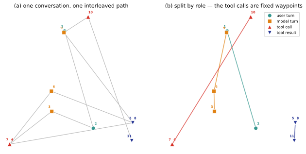
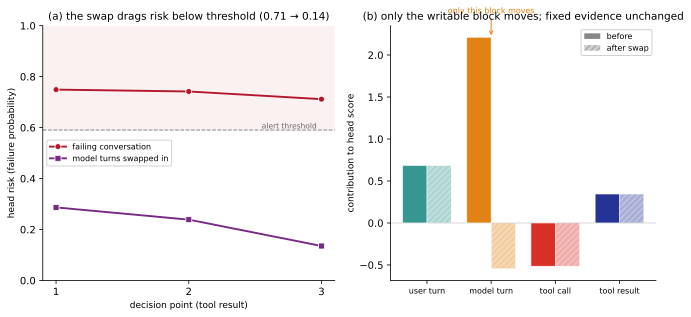
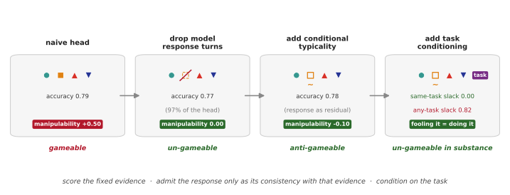

# Manipulability of Trajectory-Geometric Conversation Rewards and a Role-Restricted, Task-Conditioned Construction

```{=latex}
\noindent{\small\textbf{Jacob Sussmilch}}\\[1pt]{\footnotesize Heya Enterprises Pty Ltd}\vspace{0.4em}
```

---

## Abstract

A dense reward that scores a conversation on every turn is what reinforcement
learning wants where the true outcome is sparse and late — and what
Goodhart's law warns will be gamed. We show it need not be. Trajectory
geometry is a genuine within-domain failure signal — it predicts failure
before a task-oriented call ends — but as a reward it is gameable by
selection over real turns alone, with no training required. Its exploitability,
however, is not a property of "content": it is a property of *which role the
adversary can write*. A model optimizing the reward controls only its own
turns; the user's turns, the tool calls, and the tool results are fixed
evidence of what happened. From that observation we construct a dense,
action-anchored reward: *score the fixed evidence, admit the model's
reasoning and response only as its consistency with that evidence, condition
on the task*. The construction recovers 97–99% of a strong geometric
failure-predictor's accuracy while remaining un-gameable by the selection
adversary that breaks the naive proxy — and, where the true outcome is
recomputable from the actions, un-gameable *in substance*: fooling it
requires actually completing the task. Results hold across two task-oriented
corpora and a strong encoder, judged throughout with verified labels and
per-turn human ratings rather than an LLM judge.

---

## 1. Introduction

A conversational agent that resolves a user's problem and one that merely
sounds like it did are indistinguishable to any objective that scores the
surface of the transcript. The failures that decide whether a call resolves
— a request quietly dropped, an action claimed but never taken, a user who
gives up — live in what the model *did*, not in how fluently it narrated
doing it. This is precisely the regime where a dense, learned reward is
tempting: benchmark accuracy sees none of it, and a signal that scores the
*shape* of a dialogue could supply per-step feedback where the true outcome
is sparse and delayed. A recent proposal makes this concrete, scoring a
conversation by the geometry of its embedding trajectory and offering that
geometry as a reward signal for language models (Gooding & Grefenstette,
2025).

Reward signals, however, are not predictors. A predictor is judged on
held-out accuracy; a reward is judged on what a policy does when it optimizes
against it, and two decades of results — from wireheading and reward
tampering (Amodei et al., 2016; Everitt et al., 2021) to the
overoptimization curves of learned reward models (Gao et al., 2022) and
formal characterizations of reward hacking (Skalse et al., 2022; Pan et al.,
2022) — say the same thing: a proxy that is not the true objective can be
driven apart from it under pressure. The field's dominant response has been
to anchor rewards to *verified* outcomes wherever they exist (Lambert et al.,
2024; DeepSeek-AI, 2025). But conversation is exactly the setting where the
outcome is expensive and late, which is what makes a dense geometric proxy
attractive and what makes its gameability the question that matters.

We do not ask *whether* a trajectory-geometric proxy is gameable — Goodhart's
law predicts it is — but *what representation is robust instead*, and whether
it can keep the density that made the proxy attractive. It can, and the reward
that does is built, not tuned. Our adversary is deliberately weak — selection
over real turns, no training — so every gameability figure in the paper is a
lower bound on what a trained policy could find (§3). The construction, and
the three findings that place it:

1. **A constructed reward that keeps the accuracy and resists the policy that
   optimizes it.** Exploitability is a property of *which role* the adversary
   writes, not of content that feature engineering can launder — no functional
   form over an adversary-written channel is robust (§6). Scoring only the
   fixed roles — the user turns, the tool calls, and what the tools returned —
   recovers 97% of the predictor's accuracy at zero manipulability;
   re-admitting the model's reasoning and response as its conditional
   typicality against that evidence recovers essentially all of it (§4); and
   where the outcome is recomputable from the actions, conditioning on the
   task makes the reward un-gameable *in substance* (§5).

2. **The signal it defends is real where it should be.** On task-oriented
   dialogue the geometric head is strong early warning — AUC rising through
   the conversation to 0.81–0.83, so failure is visible before the call ends,
   against chance-level process baselines; on code-agent repositories the same
   signal is at chance. The domain boundary marks where the geometry is worth
   defending (§4).

3. **Its one soft step, and the bounded cost of taking it.** The construction
   admits the model's own writing exactly once, as conditional typicality, and
   the concession is bounded: at the exhaustive selection ceiling, that
   channel's residual gameability tracks the independent accuracy it adds — a
   near-conservation relation no transform of the residual escapes.
   Task-conditioning is the one lever that beats the exchange rate, and it is
   the same lever that buys substance in §5 (§7).

4. **Its manipulability, judged without an LLM judge.** We judge with verified
   outcome labels and per-turn human ratings: an LLM judge shares the
   representational blind spots of the proxies it would adjudicate, and we
   measure a case where a peak-end-biased judge prefers the exploit *more*
   than the reward is exploitable (§7).

The through-line is that "anchor rewards to verified outcomes" need not cost
the dense, per-turn signal a monitor provides — built the right way, the
verified evidence *is* scoreable geometrically, without handing the policy a
lever.

---

## 2. Background

**Reward overoptimization and hacking.** That a learned proxy reward diverges
from gold reward under optimization is established by Gao et al. (2022), with
characterizations by Skalse et al. (2022) and Pan et al. (2022); the concern
traces to Amodei et al. (2016) and the reward-tampering analysis of Everitt
et al. (2021). We study a specific proxy class — trajectory geometry — under
a weaker adversary than RL.

**Verifiable rewards.** The response that verified, checkable outcomes are
the robust anchor is the premise of RL with verifiable rewards (Lambert et
al., 2024, which coins the term; DeepSeek-AI, 2025, the highest-profile
application). Our robustness result is, in effect, a mechanistic account of
*why* verifiable actions resist gaming: a policy cannot select its way to a
tool call that did not fire.

**Process vs. outcome reward.** The tension between a dense per-step signal
and a sparse verified outcome is the process/outcome reward distinction
(Uesato et al., 2022; Lightman et al., 2023). Our early-warning predictor is
a process signal; part of the paper is about the limits of process signals
built from surface geometry.

**LLM-judge bias.** LLM judges exhibit position, verbosity, and self-
enhancement biases (Zheng et al., 2023; Dubois et al., 2024). We add a
measured instance of *peak-end* bias (Kahneman et al., 1993) and use it to
motivate judging with verified labels and per-turn human ratings instead.

**Trajectory-geometry rewards and agentic evaluation.** The direct
predecessor proposes conversational geometry as a reward signal (Gooding &
Grefenstette, 2025); we measure the gameability its offline evidence could
not. Our corpora and the action-grounding results connect to agentic
tool-use evaluation (Qin et al., 2023; Yao et al., 2024; Liu et al., 2023).

---

## 3. Setup

**Corpora.** We evaluate on task-oriented conversation corpora that carry a
verified or deterministically-derived outcome label and an explicit role
structure (Table 1): ToolBench (Qin et al., 2023), ABCD (Chen et al., 2021),
SpokenWOZ (Si et al., 2023), and a public corpus of SWE-agent runs on
repository issues (Nebius, 2024; Yang et al., 2024). Each turn is embedded
with a sentence encoder (all-MiniLM-L6-v2, 384-d, L2-normalized; §7 repeats
the main result with a 1024-d encoder). We normalize every corpus to turns
typed by role plus a per-conversation outcome label. USS-SGD/MWOZ (Sun et
al., 2021), which carry per-turn human satisfaction ratings, are used only
for the judging methodology in §7.

Table 1. Corpora.

| Corpus | Conversations | Label | Failure rate | Roles |
|---|---|---|---|---|
| ToolBench | 12,598 | verified give-answer / give-up | 20.2% | user, model, tool-call, tool-result |
| ABCD | 6,399 | action-completion (deterministic) | 13.4% | customer, agent, action |
| SpokenWOZ | 5,697 | derived goal-completion | 33.6% | user, system |
| SWE-agent-traj. | 11,983 | PR-test-verified | 84.6% | user, agent, tool-result |
| USS-SGD / MWOZ | 1,000 each | per-turn human ratings | — | user, system |
<!-- src: manuscript_tables.py -->

::: tablenote
Note: Failure rate is the share of conversations carrying the negative outcome label. USS-SGD/MWOZ carry per-turn human ratings and are used only for the judging analysis (§7).
:::

**The early-warning head.** For each speaker role we mean-pool its turn
embeddings into a per-role running mean, at every decision point of a
conversation prefix, and train an L2-regularized logistic head to predict
eventual failure, out-of-fold and grouped by conversation. This is the simplest
trajectory-geometric representation — the degree-0 (position) term, dropping the
degree-1 *dynamics*, the direction the conversation is moving, that the
predecessor emphasizes. The representation closes a two-paper lineage: a
companion method paper establishes the projection whose degree-0 term this is
(Sussmilch, 2026b), and a companion representation study recommends the
role-split projection for satisfaction prediction while flagging that the
best predictor may be the most gameable reward (Sussmilch, 2026a) — the flag
this paper answers. That the results below hold even at mean pooling is the
point: the manipulability structure is a property of the *role split*, not the
geometric order (§6). This is a strong within-domain process predictor (§4).

Figure 1 makes the representation concrete on one real failing ToolBench
conversation. Each turn is a point in a 2-D projection of its embedding;
panel (a) reads the conversation as one interleaved path, and panel (b) splits
it into one sub-path per role. The split is what the construction turns on:
the user's turns, the tool calls, and the tool results are fixed points of
the record — the model's turns are the only role a policy optimizing the
reward can write.


<!-- src: paper_figures.py -->

Figure 1: one real failing ToolBench conversation as a projected trajectory — (a) the interleaved path over all roles; (b) split by role, with the tool calls as fixed waypoints of the record.

**The selection attack, and manipulability.** To apply optimization pressure
without training a policy, we attack the reward by selection over real turns:

1. Freeze the trained head and an alert threshold (the lowest threshold
   reaching precision $\geq$ 0.5 on a training fold).
2. For each held-out *failing* conversation, replace each upcoming model turn
   with the best of n real model turns drawn from *successful* training
   conversations — "best" meaning the one that minimizes the head's risk
   score. The user turns, tool calls, and tool results are never touched.
3. Score the substituted conversation against its *verified* outcome label,
   which the substitution does not change (or, where the label is
   action-computable, recomputes).

Manipulability is the fraction of the reward's failure alerts the attack
erases: (base recall − recall after attack) / base recall, where a
conversation alerts if any decision-point score crosses the threshold. The
sign convention carries through the paper: manipulability > 0 is *gameable*
(the attack suppresses alerts), 0 is *un-gameable against this attack*, and
< 0 is *anti-gameable* — the attack raises the alert rate. The budget n is
the optimization pressure: n = 1 is random substitution (the drift control),
best-of-16 is the working budget, and n = |pool| is the exhaustive selection
ceiling. Selection over real turns is strictly weaker than any trained
policy, so every manipulability figure in this paper is a lower bound.

**Three senses of "un-gameable."** Robustness claims come in three strengths,
and each result below states which it carries:

- *Scoped*: this attack, at this budget, cannot move the reward. The weakest
  sense; always stated with the adversary and budget.
- *Structural*: the writable channel is absent from the score's inputs, so no
  adversary confined to writing the model's turns has a lever — against
  selection, RL, or a generative attacker equally. The score is still a
  proxy; the adversary just cannot reach the inputs that would open the gap.
- *In substance*: no proxy gap remains. The label is a deterministic function
  of the scored actions, so raising the reward and succeeding at the task are
  the same event.

**Judging.** Manipulability is judged against the verified outcome label. The
satisfaction-shape analysis (§7) uses per-turn human ratings, not an LLM
judge, for reasons that section makes empirical.

---

## 4. A dense reward that resists gaming

**The predictor we defend.** The early-warning head is a strong within-domain
failure predictor: on task-oriented dialogue its accuracy rises monotonically
through the conversation, seeing failure form before the call ends, while no
non-geometric process feature clears chance on ToolBench — the geometry, not
a length or step-count proxy, carries the signal (Table 2). Deployed as a
monitor at its precision-0.5 operating point, it catches 57% of failures at a
14% false-alarm rate, with a median lead of two tool
steps<!-- src: tb3_head.py -->. It transfers to
genuine spoken transcripts at attenuated strength and is at chance on
repository-specific code-agent trajectories, where simple process baselines
carry what signal exists — a domain boundary.

Table 2. Early-warning accuracy by conversation quartile.

| Corpus | Q1 | Q2 | Q3 | Q4 | best process baseline (Q4) |
|---|---|---|---|---|---|
| ToolBench | 0.705 | 0.799 | 0.813 | 0.834 | step-count 0.496 |
| ABCD | 0.699 | 0.742 | 0.786 | 0.812 | goal-dist 0.567 |
| SpokenWOZ | 0.575 | 0.632 | 0.665 | 0.690 | step-count 0.548 |
| SWE-agent-traj. | 0.505 | 0.508 | 0.519 | 0.522 | step-count 0.712 |
<!-- src: manuscript_tables.py -->

::: tablenote
Note: Each conversation's decision points are bucketed into four position quartiles (Q1 earliest → Q4 final), and AUC — out-of-fold, grouped by conversation — is computed within each. The baseline is the best non-geometric process signal at Q4.
:::

Like any dense proxy, it is gameable: the selection attack suppresses half
its alerts on ToolBench and most of them on ABCD (§6 gives the full picture,
and rules out the obvious defenses). Figure 2 shows the exploit on the
conversation of Figure 1: because the head score is a sum of per-role
contributions, the attack moves only the writable model-turn block, while the
user turns, the tool calls, and the "endpoint disabled" tool result that
shows the conversation failed contribute identically before and after. We now
build a reward that keeps this accuracy while the selection adversary cannot
move it.


<!-- src: paper_figures.py -->

Figure 2: the selection attack on the Figure 1 conversation, shown in the head's own decision terms. (a) the head's failure risk at each decision point: the failing conversation stays above the alert threshold throughout, while swapping the model turns for real turns that score low drags the risk below it at every point. (b) the head score is a sum of per-role contributions; the attack moves only the model-turn (writable) block, while the user turns, tool calls, and tool results — including the "endpoint disabled" evidence — contribute identically before and after.

Figure 3 is the construction in overview: each stage scores a different set
of role channels (the four glyphs are the roles of Figures 1–2), from the
gameable naive head, through dropping the written role, to re-admitting it as
typicality and conditioning on the task. The rest of this section establishes
the first two moves (Table 3) and §5 the third (Table 4); the headline
numbers in the figure are the same artifacts those tables print.


<!-- src: paper_figures.py -->

Figure 3: the construction in four stages — the naive head (all roles, gameable) → drop the written role → re-admit the reasoning and response as its conditional-typicality residual → condition on the task; each stage's role channels, accuracy, and manipulability/slack loaded from the artifacts.

**Dropping the written role.** A model optimizing the reward
controls only its own turns — its internal reasoning and response. The user's
turns, the tool calls, and the tool *results* are fixed evidence of what
happened, and the role split lets us drop exactly the written role and keep
everything else. Table 3 is the result: the fixed-role head is un-gameable
structurally — none of its inputs is the adversary's to move — and it loses
almost nothing, recovering 97% of the full head's accuracy. The written role
carried the gameability and almost none of the *unique* accuracy. The
restriction also keeps the early warning: at a matched false-alarm rate the
fixed-role head catches 37% (ToolBench) and 40% (ABCD) of all failures at
least two decision points early, where a same-turn-content baseline at the
identical operating point catches 29% and 35%; the median lead is two
decision points on ToolBench and six on ABCD<!-- src: round17.py -->. That
lead is one a policy cannot suppress by narrating over it.

The dropped role can then be re-admitted safely, as its **conditional
typicality** against the evidence:

1. Fit a model (a ridge regression) predicting the model's turn embedding
   from the fixed context — what the user turns, tool calls, and tool results
   imply the model would say.
2. Admit the model's actual writing only as its residual: the distance
   between what it wrote and what the evidence implies.

Writing consistent with the record is typical; success-shaped writing atop a
failing record is atypical. This recovers essentially the full accuracy
(Table 3) and turns the attack against itself: an adversary trying to look
successful raises the residual, which raises the alert rate — at best-of-16
the reward is anti-gameable. Swept to the exhaustive ceiling the
anti-gameability erodes to marginally gameable, a residual §7 shows tracks
the accuracy the channel adds and task-conditioning roughly halves.

Table 3. The construction (ToolBench).

| Representation | Accuracy AUC | Manipulability |
|---|---|---|
| full head (all roles, incl. model turns) | 0.788 | +0.50 |
| grounding only (tool identity) | 0.706 | 0.00 |
| **fixed roles (drop the written role)** | **0.769** | **0.00** |
| **+ conditional typicality of the reasoning and response** | **0.782** | **−0.10** |
<!-- src: manuscript_tables.py -->

::: tablenote
Note: Manipulability at the best-of-16 budget (§3 gives the sign convention; Table 8 sweeps the re-admitted channel to the exhaustive ceiling); accuracy is out-of-fold AUC.
:::

---

## 5. Un-gameable in substance: conditioning on the task

The fixed-role reward is un-gameable structurally, but it remains a proxy: a
policy that chooses its own actions could still drive the score apart from
the outcome. On ABCD, whose label is a deterministic function of the action
sequence, we can test the stronger claim — un-gameable *in substance* —
directly: replace a failing conversation's actions with a successful one's,
and recompute the *true* label of the gamed sequence (Table 4). When the
substituted actions come from the *same task*, every suppressed alert also
flips the real label to success (slack 0): you cannot look successful at this
task without performing it. When the actions may come from *any* task, the
task-blind detector is fooled every time but the task genuinely succeeds only
18% of the time — a policy games it with generic success-shaped actions that
do not resolve this user's problem. The 82% slack is the price of not
conditioning on the task, and the last piece of the recipe: score the
evidence *against the specific task*.

Table 4. Gaming the action grounding requires real success — only if the
detector knows the task (ABCD).

| Substituted actions | Detector fooled | Real task succeeded | Slack (fooled, not succeeded) |
|---|---|---|---|
| same task | 96% | 100% of those fooled | 0.00 |
| any task | 100% | 18% of those fooled | 0.82 |
<!-- src: manuscript_tables.py -->

::: tablenote
Note: Slack is the share of fooled cases (alert suppressed) where the true task did not succeed; 0 means fooling the detector requires real success. The ABCD label is a deterministic function of the action sequence.
:::

The recipe is now complete: **score the fixed evidence, admit the model's
reasoning and response only as its consistency with that evidence, and
condition the whole thing on the task.**

---

## 6. Why nothing simpler works

The construction drops an entire role and models the rest. Two cheaper
shortcuts suggest themselves — defend the head by *adding* the action
grounding, or by *transforming* its content — and both fail; the reason is
general enough to close them off in principle.

**The naive head is broken by the weakest adversary (Table 5).** The random
(n = 1) control is roughly flat, so the suppression is genuine selection, not
distribution shift. Swept to the exhaustive ceiling the suppression only
deepens, to +0.67 on ToolBench<!-- src: adversary_sweep.py -->, so the
best-of-16 cells understate the naive head's exploitability. A monitored channel-divergence tripwire reduces the
manipulability but leaves a large on-manifold residual; a relational
(TRACE-style) suite is too weak a predictor to place on the scale. Because a
selection adversary already achieves this, the RL optimizer is irrelevant to
the vulnerability — it is in the reward.

Table 5. Manipulability of the naive head, and a monitored governance
term.

| Corpus | Representation | Accuracy AUC | Manipulability |
|---|---|---|---|
| ToolBench | naive geometric head | 0.788 | 0.50 |
| ToolBench | + channel-divergence tripwire | 0.788 | 0.32 |
| ToolBench | TRACE-style relational suite | 0.674 | (predictor too weak) |
| ABCD | naive geometric head | 0.76 | 0.87 |
| ABCD | + channel-divergence tripwire | 0.76 | 0.51 |
| SpokenWOZ | naive geometric head | 0.64 | 0.73 |
<!-- src: manuscript_tables.py -->

::: tablenote
Note: Manipulability as in Table 3. The channel-divergence tripwire is a monitored governance term; the TRACE-style relational suite is too weak a predictor to place on the scale.
:::

**No feature-engineering fix recovers the accuracy safely (Table 6).**
Bolting the grounding onto the head leaves it exactly as gameable: a
discriminative head weights the channel that predicts best, not the one that
is safe. Binding the content *relationally* to the grounding — letting it
enter only as its cosine to the action record — makes things *worse*, because
a low-dimensional relational feature is an easier target for the adversary,
not a harder one; a consistency gate is equally leaky. The reason is
structural. Against selection over a candidate pool the *shape* of the
scoring function is irrelevant — the adversary evaluates it over its
candidates and takes the minimum — so no functional form over an
adversary-written channel is robust. A bilinear coupling $g_0^\top M s$ between
content $g_0$ and fixed grounding $s$ is, for fixed $s$, the linear functional
$\langle g_0, Ms\rangle$, minimized by the pool turn most anti-aligned with $Ms$. Only
removing the written channel entirely reaches manipulability 0 — which is why
the construction drops the role rather than trying to tame it, and why
re-admitting the model's writing required the typicality residual (§4) rather
than any transform of the content itself.

Table 6. Every scheme that admits the adversary's content stays gameable
(ToolBench).

| Representation | How model content enters | Accuracy AUC | Manipulability |
|---|---|---|---|
| naive head | free absolute position | 0.788 | 0.50 |
| additive tether | free position + action grounding | 0.788 | 0.50 |
| relational binding | only as cosine-to-grounding | 0.762 | 0.68 |
| grounding gate | content gated by consistency | 0.757 | 0.67 |
| fixed roles + conditional typicality (§4) | as consistency residual | 0.782 | −0.10 |
| grounding only | not admitted | 0.706 | 0.00 |
<!-- src: manuscript_tables.py -->

::: tablenote
Note: Manipulability as in Table 3. Every scheme that admits the adversary's content stays gameable; only dropping the written role reaches 0.
:::

---

## 7. Robustness, and how manipulability is judged

**The construction replicates across corpora and encoders (Table 7).** On
ABCD — whose naive head is the most gameable in the study — dropping the
written role again yields manipulability 0, and in fact *exceeds* the full
head's accuracy: the written role was net-negative for accuracy and carried
all of the exploitability. Re-encoding ToolBench with a strong 1024-d encoder
(bge-large-en-v1.5) raises every accuracy but leaves the manipulability
structure intact — the full head still gameable, the fixed-role head still
un-gameable structurally, the typicality head anti-gameable at best-of-16 and
reaching 99% of the full head's accuracy. The effect is a property of which
role the adversary writes, not of a weak or low-dimensional embedding.

Table 7. Robustness — second corpus (ABCD) and strong encoder (BGE-large,
ToolBench).

| Representation | ABCD AUC | ABCD manip | BGE AUC | BGE manip |
|---|---|---|---|---|
| full head | 0.769 | +0.80 | 0.802 | +0.45 |
| grounding only | 0.643 | 0.00 | 0.712 | 0.00 |
| fixed roles (drop written role) | 0.772 | 0.00 | 0.786 | 0.00 |
| + conditional typicality | 0.773 | 0.00 | 0.797 | −0.04 |
<!-- src: manuscript_tables.py -->

::: tablenote
Note: Manipulability and AUC as in Table 3. BGE-large is a 1024-d encoder (MiniLM is 384-d); the manipulability structure holds across both encoders.
:::

**The re-admitted written role's robustness under a stronger adversary (Table
8).** A best-of-16 number understates the one channel the adversary can
write. Swept to the exhaustive selection ceiling, the plain typicality
residual erodes to marginally gameable, and its ceiling gameability tracks
the independent accuracy it adds — a near-conservation law (rank correlation
0.83 on ToolBench, the one setting where the residual carries enough signal
to test it). One-sided rectification only slides along that line, trading
accuracy for gameability, and where the residual is uninformative (ABCD) it
overfits and reintroduces a lever. The exception is task-conditioning:
fitting the typicality against *p(reasoning and response | evidence, task)*
halves the ceiling gameability at equal accuracy on ToolBench and flips it
anti-gameable on BGE, because a real turn typical for *this* task's failing
state is far rarer in the candidate pool. The same lever that makes the
action grounding un-gameable in substance (§5) makes the re-admitted written
role robust.

Table 8. The re-admitted written role at the exhaustive selection ceiling,
and the task-conditioned fix.

| Re-admission | ToolBench | BGE-large | ABCD |
|---|---|---|---|
| conditional typicality | +0.030 | +0.005 | 0.000 |
| + task-conditioned | +0.014 | −0.013 | 0.000 |
<!-- src: manuscript_tables.py -->

::: tablenote
Note: Manipulability at the exhaustive selection ceiling (argmin over the whole success-turn pool), at matched accuracy; Tables 3 and 7 give the best-of-16 values. Task-conditioning fits the typicality model on the evidence *and* the task descriptor.
:::

*Honest caveat.* The recovered accuracy leans on tool-result content — what
the tools actually returned — which is outcome-adjacent (on ABCD the label is
computed from the actions). This is a *feature* for a reward: outcome-
adjacent evidence is exactly what a reward should anchor to. The claim is not
that dialogue shape carries the signal, but that the non-spoofable *evidence*
is nearly as predictive as the full head and un-gameable, while the model's
writing adds exploitability but little independent signal. The clean,
label-independent result is the manipulability structure, which holds on both
corpora.

**Why not an LLM judge.** A natural alternative to a verified label is to
reward the *shape* of satisfaction — its trend and recovery — rather than its
level, and to judge with an LLM. Both parts fail, measurably. A
manipulation-safe shape reward is weak: restricting it to the model's own
channel (to deny a gradient on the user it could manipulate) roughly halves
the trend signal, which lives substantially in the user channel (Table 9,
left). And under selection the safe trend reward is Goodhart-divergent — its
own score rises while the per-turn human final-turn rating falls (Table 9,
right). We could not adjudicate this with an LLM judge: a whole-transcript
judge carries a peak-end bias (Kahneman et al., 1993) that prefers a
manufactured improvement arc *more* strongly than the reward can be gamed to
produce it — the judge shares the reward's blind spot. This is why
manipulability throughout is judged against verified labels and per-turn
human ratings.

Table 9. The satisfaction-shape alternative fails on both counts.

| Trend-signal strength (rank corr.) | SGD | MWOZ |
|---|---|---|
| model-channel only (manipulation-safe) | 0.216 | 0.149 |
| user channel alone (unsafe) | 0.423 | 0.312 |
| both roles | 0.416 | 0.304 |
<!-- src: manuscript_tables.py -->

| Shape reward under selection (Δ from random) | Δ own score | Δ human final-turn rating |
|---|---|---|
| trend reward, SGD | +0.091 | −0.143 |
| trend reward, MWOZ | +0.074 | −0.114 |
<!-- src: manuscript_tables.py -->

::: tablenote
Note: Rank corr is Spearman between the model-channel shape reward and the trend target. Δ is the change from random substitution: the reward's own score versus the per-turn human final-turn rating.
:::

---

## 8. Limitations

Two of the items below are declared scope decisions (6, 7); the rest are
measured limitations of the evidence.

1. **The manipulability figures are lower bounds.** Selection over real turns
   cannot synthesize the novel turn a generative adversary could produce, so a
   trained policy could find more than any number here reports.
2. **The robustness is conditional.** "Un-gameable" is scoped to the
   substitution adversary; the decisive substance result is scoped further to
   task-conditioning, with the 82% task-blind slack the standing reminder that a
   task-blind detector is fooled by generic success-shaped actions.
3. **The conservation relation is measured where it can be.** It is clean only
   where the re-admitted channel carries independent signal (ToolBench/MiniLM);
   on the strong encoder and on ABCD the ceilings cluster too near zero to test
   it. One-sided rectification, where the residual is uninformative, can
   reintroduce gameability rather than remove it; task-conditioning is the
   reliable lever, and its exchange-rate gain is measured on two corpora at
   modest magnitudes.
4. **Substance needs a recomputable label.** The un-gameable-in-substance result
   exploits that one corpus's label is a deterministic function of the visible
   actions (ABCD); the other, whose label is independent of them, is the cleaner
   but weaker cross-check.
5. **The recovered accuracy is outcome-adjacent.** It leans on tool-result
   content — what the tools actually returned — which we argue above is a
   feature for a reward rather than a bug, but which is stated plainly here.
6. **Offline selection only.** No policy was trained and no RL loop was run; all
   optimization is offline selection over real turns.
7. **Public role-play corpora.** The corpora are public and predominantly
   Wizard-of-Oz or crowdworker role-play, not production traffic.
8. **The shape-target evidence is third-party.** All satisfaction-shape evidence
   (§7) is third-party annotator dynamics on long task-oriented dialogue, not
   lived user experience.

---

## 9. Conclusion

Trajectory geometry is a genuine within-domain failure signal — strong on
task-oriented dialogue, at chance where the transcript is a code repository —
but as a reward proxy it is gameable by selection alone, which settles the
reward-vs-monitor question against using the naive signal as a training
target. The constructive result is the useful one: exploitability is a
property of the role the adversary can write, not of content, so the reward
that works is built, not tuned — score the fixed evidence, re-admit the
model's writing only as its typicality against that evidence, condition on
the task. The construction keeps the density a monitor needs while resisting
the adversary that breaks the naive proxy. The natural next step is the one
no public corpus can follow: the same construction on production calls with
outcome-verified, task-labeled logs, where the recipe becomes a deployed
reward rather than a laboratory one.

---

## Reproducibility Statement

All experiments use public data (ToolBench, ABCD, SpokenWOZ, SWE-agent
trajectories, and USS-SGD/MWOZ) and public embedding models (all-MiniLM-L6-v2
and bge-large-en-v1.5, both off-the-shelf), and every cited artifact carries its
git commit, script sha256, and seed (42 throughout). The reproduction kit is
public at `github.com/suisuss/mtgcr-paper` (Appendix A).

---

## Appendix A. Reproduction Kit

The reproduction kit is public at `github.com/suisuss/mtgcr-paper`: a
portable pipeline spec plus the standalone generator scripts it enumerates,
regenerating every artifact from public data with one command (`./run.sh`). A
fast `./run.sh check` validates the paper against its shipped artifacts without
reproducing them: every table cell is regenerated from its source artifact and
matched against paper.md (Tables 1-9 by `manuscript_tables.py`, each cell
checked), every figure and cited result names the script that produced it, every
artifact is provenance-clean (git commit, script sha256, and seed recorded, all
built from a clean checkout), and the committed PDF rebuilds from source with
matching content. The pre-registrations (the R-series files) close before any
outcome-correlated run, fixing the segmentation, the clustering, the
manipulability metric, the selection attack, and each round's kill/keep criteria
in writing. The claim-to-script-to-artifact map covers every generated table —
the corpora and early-warning tables (1-2), the construction and the schemes
that fail to match it (3, 5-6), the substance and cross-corpus robustness results
(4, 7), the accuracy/gameability frontier (8), and the satisfaction-shape
controls (9) — and the three figures. <!-- ref: README.md -->

---

## References

Amodei, D., Olah, C., Steinhardt, J., Christiano, P., Schulman, J., & Mané, D.
(2016). *Concrete Problems in AI Safety*. arXiv:1606.06565.

Chen, D., Chen, H., Yang, Y., Lin, A., & Yu, Z. (2021). *Action-Based
Conversations Dataset: A Corpus for Building More In-Depth Task-Oriented
Dialogue Systems*. NAACL 2021. arXiv:2104.00783.

DeepSeek-AI. (2025). *DeepSeek-R1: Incentivizing Reasoning Capability in LLMs
via Reinforcement Learning*. *Nature*, 645, 633–638. arXiv:2501.12948.

Dubois, Y., Galambosi, B., Liang, P., & Hashimoto, T. B. (2024). *Length-
Controlled AlpacaEval: A Simple Way to Debias Automatic Evaluators*.
arXiv:2404.04475.

Everitt, T., Hutter, M., Kumar, R., & Krakovna, V. (2021). Reward Tampering
Problems and Solutions in Reinforcement Learning: A Causal Influence Diagram
Perspective. *Synthese*. arXiv:1908.04734.

Gao, L., Schulman, J., & Hilton, J. (2022). *Scaling Laws for Reward Model
Overoptimization*. arXiv:2210.10760. (ICML 2023.)

Gooding, S., & Grefenstette, E. (2025). *Interaction Dynamics as a Reward
Signal for LLMs*. arXiv:2511.08394.

Kahneman, D., Fredrickson, B. L., Schreiber, C. A., & Redelmeier, D. A.
(1993). When More Pain Is Preferred to Less: Adding a Better End.
*Psychological Science*, 4(6), 401–405.

Lambert, N., Morrison, J., Pyatkin, V., ... Hajishirzi, H. (2024). *Tülu 3:
Pushing Frontiers in Open Language Model Post-Training*. arXiv:2411.15124.

Lightman, H., Kosaraju, V., Burda, Y., ... Cobbe, K. (2023). *Let's Verify
Step by Step*. arXiv:2305.20050. (ICLR 2024.)

Liu, X., et al. (2023). *AgentBench: Evaluating LLMs as Agents*.
arXiv:2308.03688. (ICLR 2024.)

Nebius. (2024). *SWE-agent-trajectories* [dataset].
huggingface.co/datasets/nebius/SWE-agent-trajectories.

Pan, A., Bhatia, K., & Steinhardt, J. (2022). *The Effects of Reward
Misspecification: Mapping and Mitigating Misaligned Models*. ICLR 2022.
arXiv:2201.03544.

Qin, Y., et al. (2023). *ToolLLM: Facilitating Large Language Models to
Master 16000+ Real-world APIs*. arXiv:2307.16789. (ICLR 2024.)

Si, S., Ma, W., Gao, H., ... Li, Y. (2023). *SpokenWOZ: A Large-Scale
Speech-Text Benchmark for Spoken Task-Oriented Dialogue Agents*. NeurIPS 2023
(Datasets & Benchmarks). arXiv:2305.13040.

Skalse, J., Howe, N. H. R., Krasheninnikov, D., & Krueger, D. (2022).
*Defining and Characterizing Reward Hacking*. NeurIPS 2022. arXiv:2209.13085.

Sun, W., Zhang, S., Balog, K., ... de Rijke, M. (2021). *Simulating User
Satisfaction for the Evaluation of Task-oriented Dialogue Systems*. SIGIR
2021. arXiv:2105.03748.

Sussmilch, J. (2026a). *Analysis of Conversation Trajectory Representations:
Orthogonal Projections versus Scalar Geometry for Satisfaction Prediction*.
Companion representation study; reproduction kit at
github.com/suisuss/actr-paper.

Sussmilch, J. (2026b). *Gram Projections for Conversation Trajectories: A
Polynomial Equivalent of the DCT*. Companion method paper; reproduction kit
at github.com/suisuss/gp-paper.

Uesato, J., Kushman, N., Kumar, R., ... Higgins, I. (2022). *Solving math word
problems with process- and outcome-based feedback*. arXiv:2211.14275.

Yang, J., Jimenez, C. E., Wettig, A., ... Press, O. (2024). *SWE-agent:
Agent-Computer Interfaces Enable Automated Software Engineering*. NeurIPS
2024. arXiv:2405.15793.

Yao, S., Shinn, N., Razavi, P., & Narasimhan, K. (2024). *$\tau$-bench: A Benchmark
for Tool-Agent-User Interaction in Real-World Domains*. arXiv:2406.12045.

Zheng, L., Chiang, W.-L., Sheng, Y., ... Stoica, I. (2023). *Judging LLM-as-a-
Judge with MT-Bench and Chatbot Arena*. NeurIPS 2023 (Datasets & Benchmarks).
arXiv:2306.05685.
